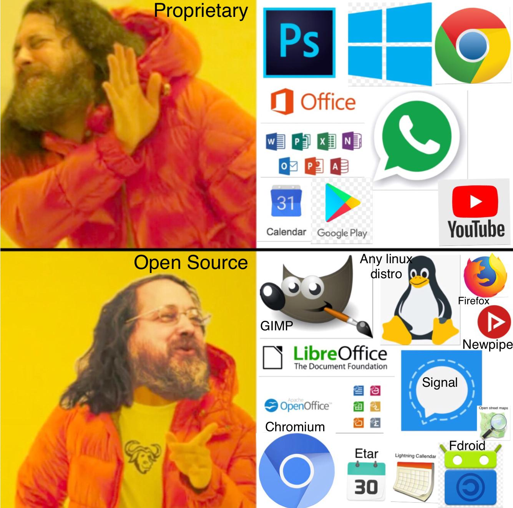
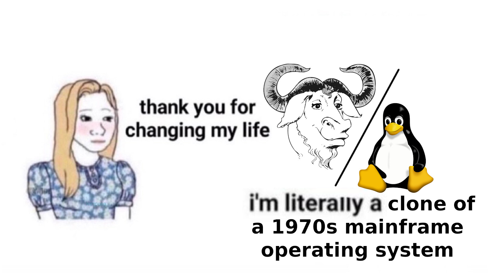

# [Hacktoberfest 2025](https://hacktoberfest.com/)

It's that time of the year again, and this year, we call everyone to contribute to free and open source software.

What's that? [Free and open-source software](https://web.archive.org/web/20131014132149/https://www.gnu.org/philosophy/free-sw.html), simply shortened "FOSS", is any software that gives you - the user - the right to use, modify and distribute the software, as you wish, without any restrictions!

Why is this so important? Free and open-source software has been the backbone of most critical infrastructure we use - from Android phones, to servers running GNU/Linux, to the routers connecting them, and from Apple gadgets (based on BSD) to even popular apps such as VLC.

*Free* here doesn't mean _free_ as in _free clothes_, but as in _free speech_, its all about the freedom that we have.

## Why

It's important that we, users of FOSS (both knowingly and unknowingly) acknowledge its importance, and make an active effort towards its development. Why you ask? Google for example, has effectively [established a monopoly on browsers](https://www.youtube.com/watch?v=XGmZFNG-qQQ). Virtually all browser are simply skins based on Chromium. While the [Chromium project](https://www.chromium.org/chromium-projects/) is open-source, collaboration is controlled by Google. This has a huge impact on decisions such as capabilites of [ad-blocker extensions](https://www.chromium.org/chromium-projects/), which Google uses to consolidate its control over the Internet.

We encourage everyone - coder or not - to contribute to open source projects so we can steal back freedom from giga-corporate that focus solely on making profits.

## How to begin

There are numerous way a layman can begin contributing to open-source software -
1. Translations and localizations - [many projects](https://hosted.weblate.org/projects/) require an active effort to translate, so that they remain accessible to users beyond just English speaking regions. Anyone with a basic understanding of English can begin translating these projects to their native languages. [Weblate](https://hosted.weblate.org/) is a platform for doing just that
2. Help projects improve design choices by contributing to their user interfaces.
3. Spread the word! this one's easy :)
4. Lastly if you can, donate! [Liberapay](https://liberapay.com/) is one such website you can use to make contributions to developers working in their free time to maintain free software.

Obviously, the best contribution remains - to actually write code that directly improves free software projects. Most projects are hosted on either [GitHub](https://github.com/) or [Gitlab](https://gitlab.com/). While the former is non-free, the latter is.
To begin contributing to projects on these sites, you must first grasp a good understanding of [git](https://git-scm.com/book/ms/v2/Getting-Started-About-Version-Control). You can check out [this tutorial](https://www.youtube.com/watch?v=RGOj5yH7evk) if you're new.
P.S. It appears GDSC will be doing a workshop on git, so try attending that if you prefer a more hand-on approach.

## Help

If you are serious about all this, join our FOSS community - the GNU/Linux Users Group - [GLUG](https://chat.whatsapp.com/EDc7xVmP5QD5LFohzkjb03)
